# Emojis

Geometry Dash renders emojis with the [`EmoteSprite`](/classes/EmoteSprite) class, which takes its sprites from `GJ_ParticleSheet`. [`geode::Label`](/classes/geode/Label) also supports them out of the box through the [`EmojiRegistry::vanillaEmojis()`](/classes/geode/EmojiRegistry#vanillaEmojis) registry, which is attached to every label by default.

Below is every emoji with its image, its name and aliases, and its Unicode equivalents. When a Unicode emoji is entered into a text field that supports emojis, such as by pasting it from the clipboard, the game translates it into its `:name:`.

| **Emoji** | **Shortcodes** | **Unicode** |
|-----------|----------------|-------------|
|  | `:exclaim:` `:exclamation:` | `‼` `❗` |
|  | `:question:` | `❓` `❔` |
|  | `:arrow:` `:arrow_right:` `:arrowright:` | `➡` |
|  | `:arrow_left:` `:arrowleft:` | `⬅` |
| 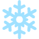 | `:snow:` `:snowflake:` | `❄` |
|  | `:smiley:` | - |
|  | `:meh:` | - |
|  | `:star:` | `⭐` `🌟` |
|  | `:like:` `:thumbsup:` | `👍` |
|  | `:dislike:` `:thumbsdown:` | `👎` |
|  | `:check:` `:yes:` | `✅` `✔` |
|  | `:diamond:` `:gem:` | `💎` |
|  | `:na:` | - |
| 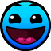 | `:easy:` | - |
|  | `:normal:` | - |
|  | `:hard:` | - |
|  | `:harder:` | - |
| 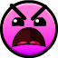 | `:insane:` `:rage:` | - |
| 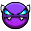 | `:easydemon:` | - |
| 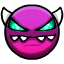 | `:mediumdemon:` | - |
| 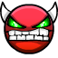 | `:harddemon:` | - |
| 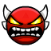 | `:insanedemon:` | - |
| 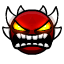 | `:extremedemon:` | - |
|  | `:auto:` | - |
|  | `:bolt:` `:zap:` | `⚡` |
|  | `:ghost:` | `👻` |
|  | `:cross:` `:no:` `:x:` | `❌` `❎` |
|  | `:lock:` | `🔒` |
| 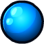 | `:orb:` | `🔮` |
| 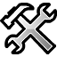 | `:tools:` | `🔧` `🛠` |
|  | `:clock:` | `⌚` `⌛` `⏰` `⏳` `🕐` `🕑` `🕒` `🕓` `🕔` `🕕` `🕖` `🕗` `🕘` `🕙` `🕚` `🕛` `🕜` `🕝` `🕞` `🕟` `🕠` `🕡` `🕢` `🕣` `🕤` `🕥` `🕦` `🕧` |
| 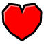 | `:favorite:` `:favourite:` | - |
|  | `:gear:` | `⚙` |
|  | `:download:` | `⬇` `📥` |
|  | `:music:` `:musical_note:` | `🎵` `🎶` |
|  | `:ban:` | `⛔` `🚫` |
| 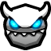 | `:keydemon:` | - |
|  | `:envelope:` `:mail:` | `✉` `📧` `📨` `📩` |
|  | `:crescent_moon:` `:moon:` | `🌙` `🌛` |
| 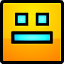 | `:cube:` | - |
| 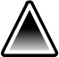 | `:spike:` | - |
|  | `:skull:` | `☠` `💀` |
|  | `:floppy_disk:` `:save:` | `💾` |
|  | `:checkpoint:` | - |
| 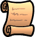 | `:quest:` | - |
|  | `:dots:` | `💬` `💭` |
|  | `:fireskull:` | - |
| 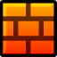 | `:brick:` `:bricks:` | `🧱` |
|  | `:trophy:` | `🏆` |
| 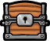 | `:chest:` | `🎁` |
| 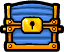 | `:bluechest:` | - |
| 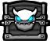 | `:demonchest:` | - |
| 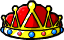 | `:royal:` | - |
|  | `:featured:` | - |
|  | `:epic:` `:fire:` | `🔥` |
| 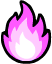 | `:legendary:` | - |
|  | `:mythic:` | - |
|  | `:heartbubble:` | - |
|  | `:rate:` | - |
|  | `:gg:` | - |
|  | `:go:` | - |
| 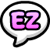 | `:ez:` | - |
|  | `:98:` | - |
|  | `:swear:` | `🤬` |
|  | `:huh:` | - |
|  | `:slight_smile:` `:slightsmile:` | `🙂` `🙃` |
|  | `:sad:` | `☹` `🙁` |
|  | `:sus:` | `🤨` |
|  | `:happy:` `:yay:` | `😃` |
|  | `:laugh:` `:laughing:` | `😆` |
|  | `:joy:` `:lol:` | `😂` `🤣` |
|  | `:star_struck:` `:starstruck:` | `🤩` |
|  | `:hyped:` | - |
|  | `:wink:` | `😉` |
|  | `:dead:` | `😵` |
|  | `:stare:` | - |
|  | `:blank:` `:neutral_face:` | `😐` `😑` `😶` |
|  | `:think:` `:thinking:` | `🤔` |
|  | `:blush:` | `😊` `😳` |
|  | `:puppyeyes:` | - |
|  | `:heart_eyes:` `:love:` | `😍` `😘` |
|  | `:party:` `:partying_face:` `:tada:` | `🎉` `🥳` |
|  | `:plead:` `:pleading_face:` `:pls:` | `🥺` |
|  | `:smirk:` | `😏` |
|  | `:smug:` | - |
|  | `:relieved:` | `😌` |
|  | `:cubeface:` | - |
|  | `:angry:` `:grr:` | `😠` `😡` `😤` |
|  | `:ninja:` | `🥷` |
|  | `:annoyed:` `:unamused:` | - |
|  | `:gasp:` `:open_mouth:` | `😮` `😯` |
|  | `:tongue:` | `😛` `😜` `😝` `🤪` |
|  | `:sob:` | `😭` |
|  | `:bawl:` | - |
|  | `:cool:` `:sunglasses:` | `😎` |
|  | `:thug:` | - |
|  | `:dizzy:` | `😵‍💫` |
|  | `:sweat:` | `😓` `😰` |
|  | `:phew:` `:sweat_smile:` | `😅` |
|  | `:yikes:` | `😨` `😬` |
|  | `:scream:` `:shocked:` | `😱` |
|  | `:astonished:` `:wow:` | `😲` |
|  | `:sick:` | `🤒` `🤧` |
|  | `:gross:` | `🤢` |
|  | `:ill:` | `😷` |
|  | `:puke:` | `🤮` |
| 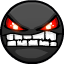 | `:shadow:` | - |
| 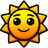 | `:sun:` | `☀` `🌞` |
|  | `:facepalm:` | `🤦` |
|  | `:hide:` | `🙈` `🫣` |
|  | `:salute:` | `🫡` |
|  | `:clown:` | `🤡` |
|  | `:sadclown:` | - |
|  | `:shrug:` | `🤷` |
|  | `:sleepy:` | `😪` |
|  | `:tired:` `:tired_face:` | `😩` `😫` |
| 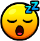 | `:sleeping:` `:snore:` `:zzz:` | `💤` `😴` `🥱` |
|  | `:monocle:` | `🧐` |
|  | `:sir:` | `🎩` |
|  | `:angel:` `:innocent:` | `😇` |
| 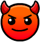 | `:devil:` `:smiling_imp:` | `😈` |
|  | `:confused:` | `😕` |
|  | `:doubt:` | `🫤` |
| 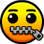 | `:zip:` `:zipper_mouth:` | `🤐` |
|  | `:eyes:` | `👀` |
|  | `:wave:` | `👋` |
|  | `:clap:` | `👏` |
|  | `:pray:` | `🙏` |
|  | `:handshake:` | `🤝` |
| 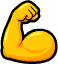 | `:flex:` `:muscle:` | `💪` |
|  | `:fist:` | `✊` `👊` |
|  | `:ok:` `:ok_hand:` | `👌` |
|  | `:peace:` | `✌` |
|  | `:point:` `:point_left:` `:pointleft:` | `👈` |
|  | `:point_right:` `:pointright:` | `👉` |
| 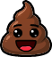 | `:poop:` | `💩` |
|  | `:popcorn:` | `🍿` |
| 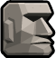 | `:bruh:` `:moyai:` | `🗿` |
|  | `:coin:` | `🪙` |
|  | `:silvercoin:` `:usercoin:` | - |
|  | `:crown:` | `👑` |
|  | `:key:` | `🔑` |
| 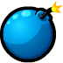 | `:bomb:` | `💣` |
| 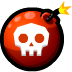 | `:nuke:` `:skullbomb:` | - |
| 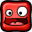 | `:redblock:` | `🟥` |
| 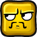 | `:goldblock:` | `🟨` |
| 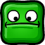 | `:greenblock:` | `🟩` |
| 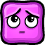 | `:pinkblock:` | `🟪` |
| 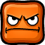 | `:orangeblock:` | `🟧` |
| 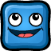 | `:blueblock:` | `🟦` |
| 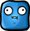 | `:bluehuh:` | - |
| 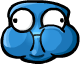 | `:blob:` | - |
|  | `:mystery:` | - |
|  | `:deathmarker:` | - |
|  | `:grin:` `:grinning:` `:smile:` | `😀` |
|  | `:beam:` | `😁` `😄` |
|  | `:evil:` | `👿` |
|  | `:sniff:` | `😥` |
|  | `:teary:` | `🥲` `🥹` |
|  | `:cry:` | `😢` |
|  | `:checkered_flag:` `:flag:` | `🏁` `🚩` |
|  | `:house:` | `🏠` |
|  | `:globe:` | `🌍` `🌎` `🌏` |
| 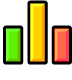 | `:chart:` | `📊` |
|  | `:chartup:` | `📈` |
|  | `:chartdown:` | `📉` |
|  | `:adore:` | `🥰` |
| 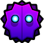 | `:wraith:` | - |
|  | `:beast1:` | - |
| 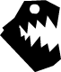 | `:beast2:` | - |
| 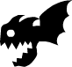 | `:beast3:` | - |
|  | `:beast4:` | - |
| 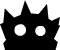 | `:beast5:` | - |
|  | `:bell:` | `🔔` |
|  | `:crossed_fingers:` `:fingerscrossed:` | `🤞` |
|  | `:eyeroll:` `:rolling_eyes:` | `🙄` |
|  | `:judge:` | `😒` |
|  | `:yum:` | `😋` |
|  | `:hug:` `:hugging:` | `🤗` |
|  | `:raised_hands:` `:raisedhands:` | `🙌` |
|  | `:sparkles:` | `✨` |
|  | `:100:` `:hundred:` | `💯` |
|  | `:heart:` | `❤` `💙` `💚` `💛` `💜` `🖤` `🤍` `🧡` |
| 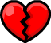 | `:broken_heart:` `:brokenheart:` | `💔` |
|  | `:pink_heart:` `:pinkheart:` | `💕` `💖` `💗` `🩷` |
|  | `:exploding_head:` `:mindblown:` | `🤯` |
|  | `:nerd:` `:nerd_face:` | `🤓` |
|  | `:sceptical:` `:skeptical:` | - |
|  | `:pensive:` | `😔` `😞` |

Below is an example using some of these emojis:

```
"This level is :fire: :100:"
```

To change which emojis a label supports, pass your own `EmojiRegistry` to `Label::setEmojiRegistry`. The vanilla registry is shared, so use `clone()` to get a copy you can extend:

```cpp
auto registry = EmojiRegistry::vanillaEmojis().clone();
registry.insert(U":my_emoji:", "my-emoji.png"_spr);
label->setEmojiRegistry(registry);
```
